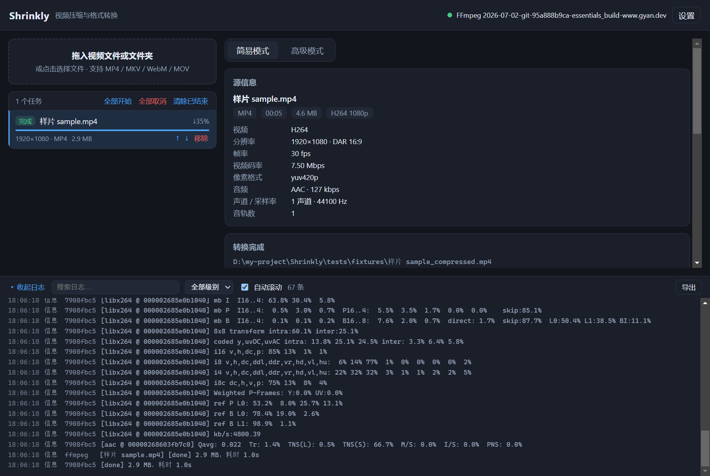

# Shrinkly

基于 FFmpeg 的 Windows 视频压缩 / 格式转换桌面工具。**一键压缩**（0–100 质量滑块）+ **目标体积**模式，支持批量队列、拖拽导入、实时估算与命令预览。

> 界面：Electron + React + TypeScript，简体中文，深色主题。
> 详细需求与实现取舍见 [PLAN.md](PLAN.md)。



---

## 1. 功能一览

| 能力 | 说明 |
| --- | --- |
| 格式转换 | 容器 **MP4 / MKV / WebM / MOV**，视频 **H.264 / HEVC / AV1 / VP9**，音频 **AAC / Opus / MP3 / FLAC / 复制 / 移除** |
| 压缩 | 质量滑块 0–100（默认 60，即「均衡」），或指定目标体积（MB） |
| 智能推导 | 按码率自动决定是否降分辨率（下限 360p）、降帧率（仅高帧率源），并在界面解释每一步理由 |
| 高级模式 | 容器 / 编码器 / CRF / 码率 / 分辨率 / 帧率 / 预设 / profile / level / 像素格式 / GOP / B 帧 / 音频参数 / 命名模板 / 冲突策略 / 额外参数 |
| 队列 | 多文件、排序、并发上限（默认 1）、单任务与全部取消 |
| 进度 | 百分比、速度、ETA、当前帧；实时日志（搜索 / 过滤 / 导出） |
| 结果 | 输出路径、实际体积、实际编码参数、压缩率、耗时、一键打开所在文件夹 |
| 健壮性 | 原子产出（`.part` → rename）、取消清理、硬件编码失败自动回退软件编码、中文/空格路径、磁盘与权限检查、错误分类与中文建议 |

---

## 2. 环境要求

- **Windows 10/11**（代码跨平台，但仅验证 Windows）
- **Node.js ≥ 20**（开发与打包）
- **ffmpeg / ffprobe**（运行时）：
  - 应用会依次查找：设置中的自定义路径 → 系统 `PATH` → 常见目录（`C:\ffmpeg`、`D:\ffmpeg`、winget / Chocolatey 安装位置）；
  - 找不到时界面顶部会出现「用 winget 安装」（执行 `winget install --id Gyan.FFmpeg`）与「选择路径」；
  - **不捆绑 ffmpeg 二进制**（规避许可与体积问题）。

---

## 3. 开发与运行

```bash
npm install          # 安装依赖
npm run dev          # 开发模式（热更新）
```

其他脚本：

| 脚本 | 作用 |
| --- | --- |
| `npm run typecheck` | 主进程 + 渲染层 TypeScript 严格检查 |
| `npm test` | Vitest 单元测试（估算 / 校验 / 参数构造 / 命名 / ffprobe 解析等） |
| `npm run test:integration` | 可选集成测试，需要 `tests/fixtures/` 里有真实样片；无样片自动跳过 |
| `npm run build` | 构建三端产物到 `out/` |
| `npm run start` | 预览构建产物 |
| `npm run build:win` | 打包便携 exe + NSIS 安装包（输出到 `release/`） |

---

## 4. 测试

### 4.1 单元测试（无需 ffmpeg）

`npm test` 覆盖：

- `shared/estimate`：CRF/码率/分辨率/帧率/音频规则、目标体积反解与不可达提示、源码率封顶、竖屏取档；
- `shared/validation`：容器 × 编码矩阵、数值边界、扩展名冲突、额外参数白名单、命名模板；
- `main/ffmpeg/args`：CRF/ABR/两遍参数、`copy` 音频不带 `-b:a/-ac/-ar`、WebM 参数、中文路径、硬件编码 CQ；
- `main/ffmpeg/probe`：封面图跳过、时长回退、码率互补估算、HDR / 隔行检测、异常 JSON；
- `main/fs/paths`：命名模板 tokens、非法字符清理、四种冲突策略、临时文件命名。

### 4.2 集成测试（可选，需要样片）

1. 把 1–3 段 10–60s 的样片放进 `tests/fixtures/`（**不入库**，见该目录 README）；
2. `npm run test:integration`。

断言包括：输出可被 ffprobe 读取、分辨率/帧率不高于源、时长误差 ≤ 0.5s、完整解码无错误、目标体积误差 ≤ ±12%、中文与空格路径、取消后无 `.part` 残留。

### 4.3 手工验收

见 [docs/manual-checklist.md](docs/manual-checklist.md)。

---

## 5. 打包

```bash
npm run build:win
```

产出（`release/`）：

- `Shrinkly-0.1.0-portable.exe`：便携版，双击即用；
- `Shrinkly-0.1.0-setup.exe`：NSIS 安装包（可选安装目录、创建桌面与开始菜单快捷方式）。

### 关于 exe 图标

`electron-builder.yml` 中默认 `win.signAndEditExecutable: false`。原因：开启后 electron-builder 会解压
`winCodeSign` 资源包，其中包含 macOS 符号链接，**普通用户权限在 Windows 上无法创建符号链接**
（需要管理员权限或开发者模式），会直接导致打包失败。

- 便携版 / 安装包无需该步骤即可正常使用（安装器图标仍使用 `build/icon.ico`）；
- 若希望把图标与版本信息写进 `Shrinkly.exe`，请以**管理员权限**运行终端（或开启「开发者模式」后）执行：

```bash
npm run build:win:iconed
```

图标由 `node build/generate-icon.mjs` 生成（`build/icon.png` 512×512 与 `build/icon.ico`）。

---

## 6. 目录结构

```
src/
├─ main/                    Electron 主进程
│  ├─ index.ts              窗口 / 安全策略 / 生命周期
│  ├─ state.ts              配置 + ffmpeg 状态 + 队列的唯一持有者
│  ├─ ipc/handlers.ts       白名单 IPC（入参全部重新校验）
│  ├─ ffmpeg/
│  │  ├─ locator.ts         路径探测 / 版本校验 / winget 安装后扫描
│  │  ├─ capabilities.ts    编码器与硬件加速能力探测（带缓存）
│  │  ├─ probe.ts           ffprobe 调用与 JSON 解析
│  │  ├─ args.ts            FFmpeg 参数构造（纯函数）
│  │  ├─ runner.ts          spawn / 进度解析 / 取消 / 卡死告警
│  │  ├─ exec.ts            子进程封装（从不经过 shell）
│  │  └─ errors.ts          stderr → 中文错误分类
│  ├─ jobs/queue.ts         队列、并发、硬件回退、原子产出
│  ├─ fs/paths.ts           命名模板 / 冲突策略 / 空间与权限
│  ├─ settings.ts           原子写入的 JSON 配置
│  └─ logger.ts             文件日志（轮转）+ 内存环形缓冲
├─ preload/index.ts         contextBridge 暴露的类型化 API
├─ shared/                  主进程与渲染层共用（纯函数，可单测）
│  ├─ types.ts  presets.ts  estimate.ts  validation.ts  ipc.ts
└─ renderer/                React 界面（简易 / 高级 / 队列 / 日志 / 设置）
```

**一致性保证**：渲染层与主进程调用**同一个** `computeEstimate` / `buildFfmpegArgs`，主进程在启动任务前再次校验参数，避免「界面显示」与「实际执行」不一致。

---

## 7. 关键设计

- **原子产出**：先写 `<name>.part.<ext>`，成功后 `rename` 到最终名；失败/取消删除临时文件，绝不留下损坏的目标文件。
- **绝不覆盖源文件**：输出路径与源相同时强制追加序号。
- **参数传递**：始终使用 `spawn` + 参数数组，**从不经过 shell**，因此中文 / 空格 / emoji 路径安全。
- **取消**：Windows 使用 `taskkill /PID <pid> /T /F` 杀整棵进程树。
- **硬件编码**：NVENC → QSV → AMF 优先级探测并实测可用性；初始化失败自动回退软件编码并标注 `[hw-fallback]`。
- **安全**：`contextIsolation: true`、`nodeIntegration: false`、`sandbox: true`、白名单 IPC、CSP、禁止外部导航与新窗口。

---

## 8. Git 工作流与回退

提交序列（Conventional Commits，每步可独立回退）：

| # | 提交信息 |
| --- | --- |
| 0 | `docs: add implementation plan and repository ignore rules` |
| 1 | `chore: init electron-vite + react + ts project` |
| 2 | `feat(shared): add media types, presets and quality mapping` |
| 3 | `feat(shared): add estimate and validation with unit tests` |
| 4 | `feat(main): probe media and locate ffmpeg` |
| 5 | `feat(main): build ffmpeg args, run jobs with progress and cancel` |
| 6 | `feat(ui): implement simple mode with live estimate` |
| 7 | `feat(ui): add advanced mode, queue, logs and results` |
| 8 | `feat(main): winget install flow and settings persistence` |
| 9 | `test: add integration script and manual checklist` |
| 10 | `build: add electron-builder portable and nsis targets` |
| 11 | `docs: add README with usage, dependencies and limitations` |
| 12 | `chore(release): v0.1.0` |

分支：`main` 保持可交付，功能开发在 `feat/mvp-converter`，完成后 `--no-ff` 合并并打 `v0.1.0` 标签。

**回退方法**

```bash
git revert <hash>                                   # 回退单个提交（保留历史，推荐）
git switch main && git reset --hard <hash>          # 回到某个里程碑（仅本地，先确认无未提交改动）
git switch main && git branch -D feat/mvp-converter # 废弃整条功能分支
git reset --hard v0.1.0                             # 回到发布版本
```

---

## 9. 已知限制

- **估算精度**：码率模型基于经验 bpp，动画 / 静态画面 / 高噪点素材误差可能达 ±30%；目标体积模式用单遍 ABR，样片上可控制在 ±12% 内。
- **AV1 软件编码很慢**：本机无 libsvtav1，使用 `libaom-av1`（默认 `cpu-used 6`）；长视频建议改用 HEVC 或硬件 AV1。
- **HDR 不做色调映射**：仅检测并提示，输出可能偏色。
- **VFR 源**：改帧率时转 CFR，可能轻微改变时间轴；不改帧率时保留原时间戳。
- **同 CRF 下硬件编码画质略低**：界面提供一键关闭硬件加速。
- **exe 图标**：默认打包不写 exe 图标（见 §5 原因），安装器图标仍生效。
- **测试样片不入库**：集成测试需要本地样片，缺失时自动跳过。
- **仅验证 Windows**：代码未硬编码平台特有 API，但 macOS / Linux 未做实测。

---

## 10. 范围内不做

视频剪辑 / 裁剪 / 合流 / 字幕烧录 / 滤镜链编辑器、HDR→SDR 色调映射、网络串流与 DRM 输入、自动下载 ffmpeg 二进制、macOS / Linux 安装包。
