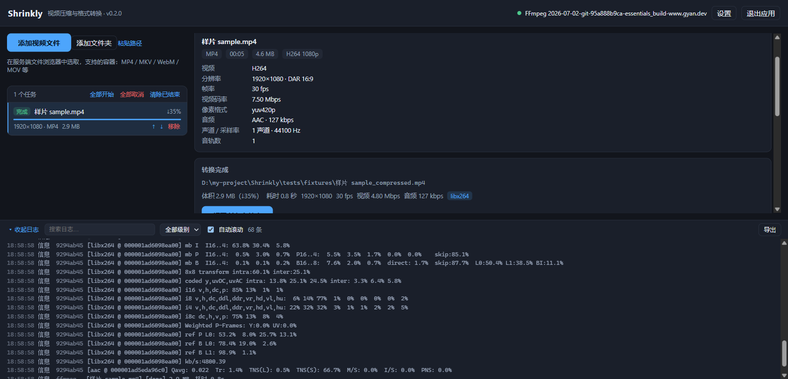

# Shrinkly

基于 FFmpeg 的 Windows 视频压缩 / 格式转换工具。**一键压缩**（0–100 质量滑块）+ **目标体积**模式，支持批量队列、实时估算与命令预览。

> **形态**：双击 exe → 本机启动 HTTP 服务 → 自动用系统默认浏览器打开 WebGUI。
> 没有原生应用窗口（Electron 只作为无窗口的托盘外壳与打包载体），关掉浏览器不影响服务，托盘里可重新打开界面。
> 技术栈：Node HTTP 服务 + React + TypeScript；界面与估算逻辑共用同一份纯函数。



---

## 1. 功能一览

| 能力 | 说明 |
| --- | --- |
| 格式转换 | 容器 **MP4 / MKV / WebM / MOV**，视频 **H.264 / HEVC / AV1 / VP9**，音频 **AAC / Opus / MP3 / FLAC / 复制 / 移除** |
| 压缩 | 质量滑块 0–100（默认 60，即「均衡」），或指定目标体积（MB） |
| 智能推导 | 按码率自动决定是否降分辨率（下限 360p）、降帧率（仅高帧率源），并在界面解释每一步理由 |
| 高级模式 | 容器 / 编码器 / CRF / 码率 / 分辨率 / 帧率 / 预设 / profile / level / 像素格式 / GOP / B 帧 / 音频参数 / 命名模板 / 冲突策略 / 额外参数 |
| 队列 | 多文件、排序、并发上限（默认 1）、单任务与全部取消 |
| 进度 | 百分比、速度、ETA、当前帧；实时日志（搜索 / 过滤 / 导出）通过 SSE 推送到浏览器 |
| 结果 | 输出路径、实际体积、实际编码参数、压缩率、耗时、一键在资源管理器中定位 |
| 健壮性 | 原子产出（`.part` → rename）、取消清理、硬件编码失败自动回退软件编码、中文/空格路径、磁盘与权限检查、错误分类与中文建议 |

---

## 2. 使用方式

### 2.1 双击 exe（发布形态）

1. 运行 `Shrinkly-<版本>-portable.exe`（便携版）或安装后从开始菜单启动；
2. 程序在 `127.0.0.1` 的随机空闲端口启动本地服务，并自动用**系统默认浏览器**打开 WebGUI；
3. 浏览器里完成全部操作；**关闭浏览器标签不会停止服务**，托盘图标右键可「打开界面 / 复制访问地址 / 打开日志目录 / 退出 Shrinkly」；
4. 界面上方的「退出应用」按钮会停止本地服务（页面随即失效）。

- 访问地址形如 `http://127.0.0.1:<端口>/?token=<一次性令牌>`；
- 实际地址还会写入 `%APPDATA%\shrinkly\runtime.json`，浏览器没有自动弹出时可在托盘「复制访问地址」获取；
- 若浏览器没有自动打开（例如默认浏览器被拦截），手动粘贴该地址即可。

### 2.2 开发模式

```bash
npm run dev
```

会同时启动 Vite 开发服务器（`http://localhost:5173`）与本地 API（`127.0.0.1:12800`），并自动用浏览器打开开发界面；
Vite 会把 `/api` 代理到本地服务，因此热更新与接口调试都能正常工作。

---

## 3. 环境要求

- **Windows 10/11**（代码跨平台，但仅验证 Windows）
- **Node.js ≥ 20**（开发与打包）
- **ffmpeg / ffprobe**（运行时）：
  - 应用依次查找：设置中的自定义路径 → 系统 `PATH` → 常见目录（`C:\ffmpeg`、`D:\ffmpeg`、winget / Chocolatey 安装位置）；
  - 找不到时界面顶部出现「用 winget 安装」（执行 `winget install --id Gyan.FFmpeg`）与「选择路径」；
  - **不捆绑 ffmpeg 二进制**（规避许可与体积问题）。

---

## 4. 开发脚本

| 脚本 | 作用 |
| --- | --- |
| `npm run dev` | Vite 开发服务器 + 本地 API + 自动打开浏览器 |
| `npm run build` | 构建服务端 bundle 与 WebGUI 到 `out/` |
| `npm start` | 用构建产物启动（等价于打包后的运行方式） |
| `npm run typecheck` | 服务端 + 渲染层 TypeScript 严格检查 |
| `npm test` | Vitest 单元测试 |
| `npm run test:integration` | 可选集成测试，需要 `tests/fixtures/` 里有真实样片；无样片自动跳过 |
| `npm run test:matrix` | 容器 × 编码全矩阵验证（自动生成合成素材） |
| `npm run build:win` | 打包便携 exe + NSIS 安装包到 `release/` |

---

## 5. 测试

### 5.1 单元测试（无需 ffmpeg）

`npm test` 覆盖：

- `shared/estimate`：CRF/码率/分辨率/帧率/音频规则、目标体积反解与不可达提示、源码率封顶、竖屏取档；
- `shared/validation`：容器 × 编码矩阵、数值边界、扩展名冲突、额外参数白名单、命名模板；
- `server/ffmpeg/args`：CRF/ABR/两遍参数、`copy` 音频不带 `-b:a/-ac/-ar`、WebM 参数、中文路径、硬件编码 CQ；
- `server/ffmpeg/probe`：封面图跳过、时长回退、码率互补估算、HDR / 隔行检测、异常 JSON；
- `server/fs/paths`：命名模板 tokens、非法字符清理、四种冲突策略、临时文件命名。

### 5.2 矩阵验证

`npm run test:matrix` 自动生成 2 秒合成素材，枚举 `shared/presets` 中所有合法组合（当前 31 个），逐个编码并做
`ffmpeg -v error -i out -f null -` 完整解码检查。

### 5.3 集成测试（可选，需要样片）

把 1–3 段 10–60s 的样片放进 `tests/fixtures/`（**不入库**），然后 `npm run test:integration`。
断言：输出可被 ffprobe 读取、分辨率/帧率不高于源、时长误差 ≤ 0.5s、完整解码无错误、目标体积误差 ≤ ±12%、
中文与空格路径、取消后无 `.part` 残留。

### 5.4 手工验收

见 [docs/manual-checklist.md](docs/manual-checklist.md)（含浏览器 / 托盘 / 端口相关检查项）。

---

## 6. 打包

```bash
npm run build:win
```

产出（`release/`）：

- `Shrinkly-0.2.0-portable.exe`：便携版，双击即启动服务并打开浏览器；
- `Shrinkly-0.2.0-setup.exe`：NSIS 安装包（可选安装目录、创建桌面与开始菜单快捷方式）。

### 关于 exe 图标

`electron-builder.yml` 默认 `win.signAndEditExecutable: false`：开启后 electron-builder 会解压
`winCodeSign`（内含 macOS 符号链接），而普通用户权限在 Windows 上无法创建符号链接（需管理员或开发者模式），会直接打包失败。

- 便携版 / 安装包无需该步骤即可正常使用（安装器图标仍使用 `build/icon.ico`）；
- 若要把图标与版本信息写进 `Shrinkly.exe`，请以**管理员权限**（或开启「开发者模式」后）执行 `npm run build:win:iconed`。

图标由 `node build/generate-icon.mjs` 生成（`build/icon.png` 512×512 与 `build/icon.ico`）。

---

## 7. 架构与目录

```
src/
├─ main/index.ts            Electron 托盘外壳：启动服务 + 打开浏览器 + 托盘菜单（无原生窗口）
├─ server/                  本地服务（纯 Node，不依赖 Electron，可单独跑）
│  ├─ http/app.ts           HTTP 服务装配：token 鉴权、静态资源、SSE、Host 校验
│  ├─ http/router.ts        极简路由 + SSE Hub + 统一错误映射
│  ├─ http/routes.ts        REST API（probe / estimate / jobs / fs / logs / shutdown）
│  ├─ http/static.ts        WebGUI 静态托管（防目录穿越 + 安全响应头）
│  ├─ state.ts              配置 + ffmpeg 状态 + 队列的唯一持有者
│  ├─ ffmpeg/               定位、能力探测、ffprobe 解析、参数构造、runner、错误分类
│  ├─ jobs/queue.ts         队列、并发、硬件回退、原子产出
│  ├─ fs/                   路径 / 命名模板 / 冲突策略 / 目录扫描
│  ├─ settings.ts           原子写入的 JSON 配置
│  └─ logger.ts             文件日志（轮转）+ 内存环形缓冲
├─ shared/                  服务端与浏览器共用（纯函数，可单测）
│  ├─ types.ts  presets.ts  estimate.ts  validation.ts  api.ts
└─ renderer/                WebGUI（React）：简易 / 高级 / 队列 / 文件浏览器 / 日志 / 设置
```

**一致性保证**：浏览器与服务端调用**同一个** `computeEstimate` / `buildFfmpegArgs`；服务端在真正启动任务前再次校验参数。

---

## 8. 本地服务的安全设计

- 只监听 **127.0.0.1**，不对局域网暴露；
- 启动时生成**一次性随机 token**，通过 URL 传给浏览器、存于 sessionStorage；所有 `/api/*` 请求必须带 `x-shrinkly-token`（SSE / 下载用 query 参数）；
- 校验 `Host` 头，阻止 DNS rebinding；不返回任何 CORS 头，其他站点无法读取响应；
- 响应附带严格 CSP 与 `X-Frame-Options: DENY`，避免被嵌入第三方页面；
- 浏览器传入的一切参数（任务参数、路径）在服务端用 Zod 重新校验。

**关键设计**：原子产出（`.part` → rename，失败/取消即删除）、绝不覆盖源文件（同路径自动加序号）、
`spawn` + 参数数组从不经过 shell（中文 / 空格 / emoji 路径安全）、取消时杀整棵进程树、
硬件编码初始化失败自动回退软件编码并标注 `[hw-fallback]`。

---

## 9. Git 工作流与回退

`main` 保持可交付；功能分支合并使用 `--no-ff`；里程碑打标签
（`v0.1.0` = 原生窗口版，`v0.2.0` 起 = 浏览器 WebGUI 版）。

```bash
git revert <hash>                                   # 回退单个提交（保留历史，推荐）
git switch main && git reset --hard <hash>          # 回到某个里程碑（仅本地，先确认无未提交改动）
git switch main && git branch -D feat/mvp-converter # 废弃整条功能分支
git reset --hard v0.2.0                             # 回到发布版本
```

---

## 10. 已知限制

- **必须能打开浏览器**：无桌面环境需手动访问 `runtime.json` 里的地址（服务本身与浏览器无关）。
- **仅本机可用**：出于安全考虑只监听 `127.0.0.1`，暂不支持局域网 / 远程访问。
- **文件选择走服务端**：浏览器拿不到本地路径，因此用内置文件浏览器选文件 / 目录；不支持从资源管理器直接拖进网页。
- **MOV 容器限制（实测）**：FFmpeg 的 mov muxer 不接受 FLAC 音轨与 AV1 视频，故 MOV 仅提供 **H.264 / HEVC + AAC / MP3**；需要 FLAC 或 AV1 请改用 MP4 / MKV。
- **估算精度**：码率模型基于经验 bpp，动画 / 静态画面 / 高噪点素材误差可能达 ±30%；目标体积模式用单遍 ABR，样片上可控制在 ±12% 内。
- **AV1 软件编码很慢**：本机无 libsvtav1，使用 `libaom-av1`（默认 `cpu-used 6`）。
- **HDR 不做色调映射**：仅检测并提示，输出可能偏色。
- **VFR 源**：改帧率时转 CFR，可能轻微改变时间轴；不改帧率时保留原时间戳。
- **exe 图标**：默认打包不写 exe 图标（见 §6），安装器图标仍生效。
- **测试样片不入库**：集成测试需要本地样片，缺失时自动跳过。

---

## 11. 范围内不做

视频剪辑 / 裁剪 / 合流 / 字幕烧录 / 滤镜链编辑器、HDR→SDR 色调映射、网络串流与 DRM 输入、自动下载 ffmpeg 二进制、macOS / Linux 安装包、多用户 / 远程访问。
